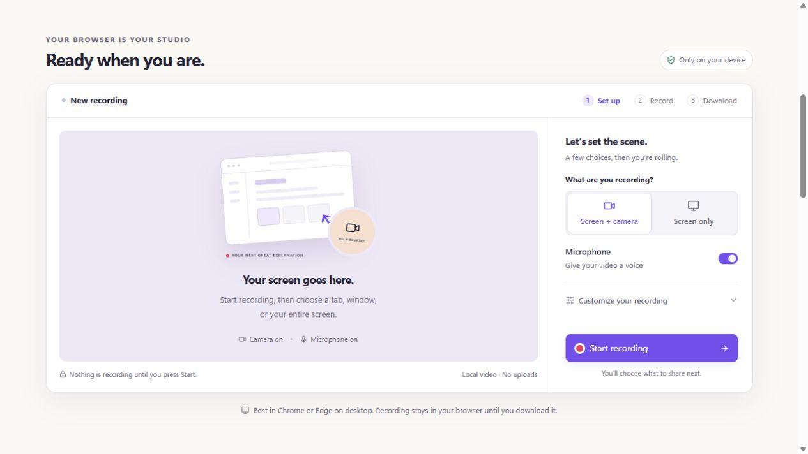

<div align="center">
  
  <h1>Kadr</h1>
  <p><strong>Show it. Make it click.</strong></p>
  <p>A free, open-source screen recorder for walkthroughs, quick updates, and clearer ideas.<br />Your screen, your camera, your voice — and a video file you control.</p>
  <p><a href="https://bilimgram.github.io/kadr/"><strong>Record a video →</strong></a> · <a href="https://bilimgram.github.io/kadr/#download">Get the desktop app</a> · <a href="docs/USER_GUIDE.md">User guide</a></p>
  <p><a href="https://github.com/bilimgram/kadr/actions/workflows/ci.yml"></a> <a href="LICENSE"></a> <a href="CONTRIBUTING.md"></a></p>
</div>



## From “quick question” to “got it”

Show a teammate how something works. Walk a customer through a fix. Give feedback with context.
Kadr makes it easy to record an explanation and take the video wherever you work.

- **No sign-up.** Open the [web recorder](https://bilimgram.github.io/kadr/) and start.
- **No watermark.** Your video stays about your message.
- **No automatic upload.** Recording happens on your device; you choose where the file goes next.
- **Open source.** Inspect the code, contribute, or build on it under Apache 2.0.

> [!NOTE]
> **Early preview.** Screen recording works today. Hosted video links, trimming, captions, and AI
> editing are planned. Kadr is building a local-first alternative to cloud screen recorders;
> it does not yet include their full collaboration and editing features.

## Your first video

1. Open [Kadr in your browser](https://bilimgram.github.io/kadr/) on a computer using Chrome or Edge.
2. Choose **Screen + camera** or **Screen only**, then turn your **Microphone** on or off.
3. Press **Start recording**. In your browser’s dialog, choose a tab, window, or screen.
4. Talk it through. **Pause** whenever you need a moment, then choose **Finish recording**.
5. Watch the preview and **Download video**. Attach the file to a message or upload it to your preferred storage.

Open **Customize your recording** to change the camera shape, bubble size, mirror setting, or countdown.
During recording, drag the bubble in the preview or focus the preview and use the arrow keys to move it.

**Save before you leave.** Browser recordings are held locally in memory until you download them.
Closing or refreshing the page can lose an unsaved video. No cloud copy is kept. Recording length
depends on your device’s available memory; use shorter takes for important material.

## Choose your workspace

|                           | Web recorder                                                      | Desktop app                                                        |
| ------------------------- | ----------------------------------------------------------------- | ------------------------------------------------------------------ |
| Get started               | [Open in your browser](https://bilimgram.github.io/kadr/)         | [Download for your OS](https://bilimgram.github.io/kadr/#download) |
| Screen source             | Pick a screen, window, or browser tab                             | Primary screen, or camera only                                     |
| Screen, camera, and voice | Yes, with browser permissions                                     | Yes, with system permissions                                       |
| Camera shapes             | Eight shapes, with live size and position controls                | Eight shapes and a floating webcam bubble                          |
| Pause and resume          | In the recording studio                                           | Floating toolbar and global shortcuts                              |
| Video output              | Preview and download an MP4 or WebM, depending on browser support | Saved to your Videos/Kadr folder                                   |
| Install required          | No                                                                | Windows, macOS, or Linux                                           |

System/tab audio depends on the platform and capture source. In a supported browser, enable audio
in the browser’s sharing dialog when available. Desktop system audio currently targets Windows.
Preview desktop builds may be unsigned; see the [installation guide](docs/USER_GUIDE.md#install).

The [desktop download section](https://bilimgram.github.io/kadr/#download) checks the latest
published version when opened. Choose Windows, macOS, or Linux; Mac users can select Apple silicon
or Intel, and Linux users can select AppImage or Debian / Ubuntu. Buttons download the installer
directly, without taking you through a developer release page.

## Your video stays yours

Kadr’s recorder does not require an account, upload your recording, or add telemetry. Browser
recordings become local downloads; desktop recordings are saved to your Videos folder. Share a
file through an app you already trust.

The web app needs to load from its host. Source-code, download, and community links go to GitHub;
the Bilimgram link goes to our website. Recordings are not sent to those services.
See [PRIVACY.md](PRIVACY.md) for details.

## What’s next

The goal is a complete, approachable recording experience with the freedom of local files.
The [roadmap](docs/PLAN.md) tracks the work:

- Trimming, captions, and a visual editor.
- AI-assisted editing using your own provider key or local models.
- Separate screen and camera tracks for editing after recording.
- Sharing to storage you control, plus optional team services.
- A native Rust capture and encoding backend.

These are planned capabilities, not features available in the current recorder.
Have a priority? [Start a discussion](https://github.com/bilimgram/kadr/discussions).

## Develop locally

You’ll need Node.js ≥ 22.12 (24 recommended) and the pnpm version pinned in `package.json`.
Rust is only needed for work in `crates/`. A short checkout path helps on Windows.

```bash
git clone https://github.com/bilimgram/kadr.git
cd kadr
corepack enable
corepack pnpm install --frozen-lockfile
corepack pnpm dev:web       # http://localhost:5173
corepack pnpm dev:desktop   # Electron app
```

```bash
corepack pnpm check         # lint, typechecks, and tests
corepack pnpm build         # production builds
```

The [development guide](docs/DEVELOPMENT.md) covers debugging, toolchains, and packaging.
The [Pages workflow](.github/workflows/pages.yml) builds the web app under `/kadr/`
and deploys it when relevant changes reach `main`.

| Path                                                 | Purpose                                              |
| ---------------------------------------------------- | ---------------------------------------------------- |
| [`apps/web`](apps/web)                               | Public homepage and browser recording studio         |
| [`apps/desktop`](apps/desktop)                       | Electron app, floating controls, native integrations |
| [`packages/compositor`](packages/compositor)         | Bubble shapes, canvas composition, light correction  |
| [`packages/recorder-core`](packages/recorder-core)   | Capture, audio mixing, and recording primitives      |
| [`packages/project-format`](packages/project-format) | Public recording and edit-plan schemas               |
| [`packages/ai-editor`](packages/ai-editor)           | Early AI edit-plan logic                             |
| [`packages/ui`](packages/ui)                         | Shared accessible controls and theme                 |
| [`crates/kadr-native`](crates/kadr-native)           | Native capture backend scaffold                      |

## Build it with us

Code, design, documentation, accessibility, and testing on different systems all help.
Read [CONTRIBUTING.md](CONTRIBUTING.md), browse
[good first issues](https://github.com/bilimgram/kadr/labels/good%20first%20issue),
or tell us what could be easier in [Discussions](https://github.com/bilimgram/kadr/discussions).
Sign off commits with `git commit -s`; contributors use the DCO rather than a CLA.

Follow our [Code of Conduct](CODE_OF_CONDUCT.md). Report security issues privately using
[SECURITY.md](SECURITY.md).

## License

[Apache-2.0](LICENSE) © The Kadr Authors. See [NOTICE](NOTICE) for attributions.
Built by [Bilimgram](https://bilimgram.uz) and contributors. “Kadr” means “frame” in Uzbek.
