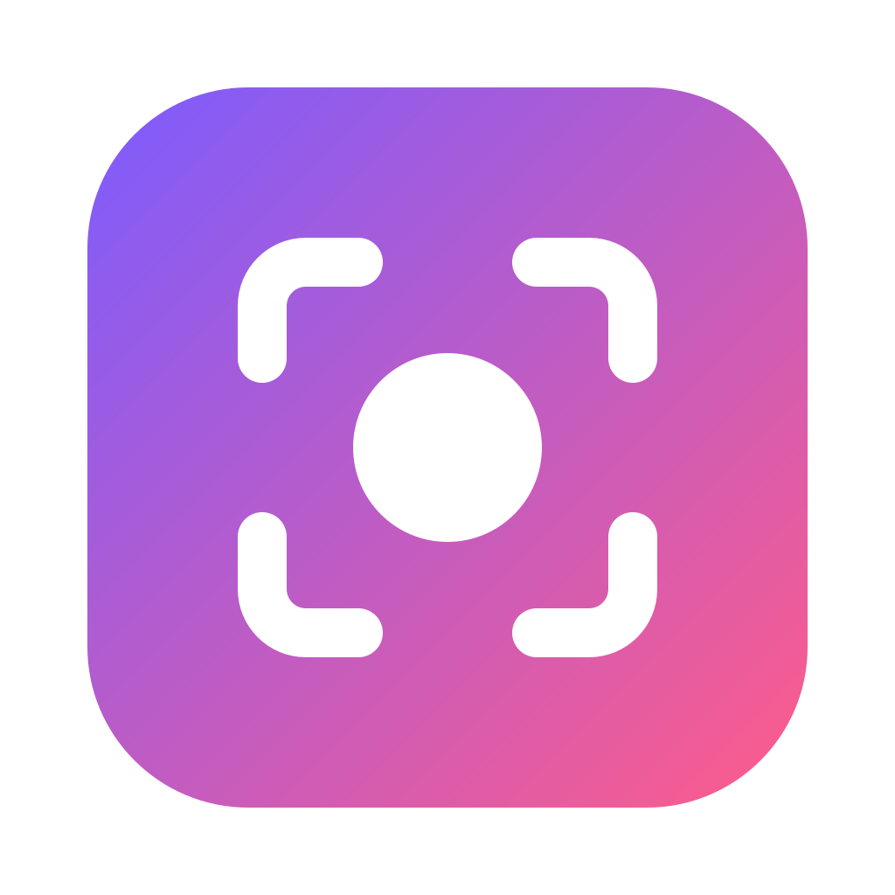

<div align="center">



# Kadr

**The open-source, local-first screen recorder.**<br/>
Record your screen with a live webcam bubble in any shape. No account, no upload, no watermark —
your recordings never leave your computer unless you share them.

[](https://github.com/bilimgram/kadr/actions/workflows/ci.yml)
[](LICENSE)
[](https://scorecard.dev/viewer/?uri=github.com/bilimgram/kadr)
[](CONTRIBUTING.md)

[**Try it in your browser**](https://bilimgram.github.io/kadr/) ·
[Download](https://github.com/bilimgram/kadr/releases/latest) ·
[User guide](docs/USER_GUIDE.md) ·
[Roadmap](docs/PLAN.md) ·
[Contributing](CONTRIBUTING.md) ·
[Discussions](https://github.com/bilimgram/kadr/discussions)

</div>

> [!NOTE]
> Kadr is in **early preview**. The recorder works today; editing, AI and sharing are on the
> [roadmap](docs/PLAN.md). It's a great time to shape the project — see [how to help](#contributing).

## Why Kadr

Async video replaced a lot of meetings, but the popular tools are closed, cloud-first and
subscription-gated. Kadr is the alternative we wanted:

- **Local-first.** Recording, saving and (soon) editing work fully offline. Files are plain MP4/WebM
  on your disk.
- **Private by design.** No account, no telemetry, nothing uploaded. When sharing ships,
  it goes to storage _you_ choose (S3, R2, MinIO) or a server you host.
- **Bring your own AI.** Planned AI editing uses your own API key (Anthropic, OpenAI, Google,
  OpenRouter) or runs locally (whisper.cpp, Ollama). No markup, no lock-in.
- **Open.** Apache-2.0, a documented project format, and no features held back from the open-source
  core ([ADR-0003](docs/adr/0003-license-and-open-core.md)).

## Features

**Available now**

- 🎥 **Screen + camera + mic** — record your screen, or just your camera; system audio on Windows.
  In the browser, pick any screen, window or tab.
- 🫧 **Live webcam bubble in your shape** — circle, squircle, rounded square, hexagon, heart, blob,
  16:9 card or 9:16 portrait; small, medium or large; drag it anywhere.
- ✨ **Automatic light correction** — GPU "touch-up" meters your face and brightens underexposed
  video (even against a bright window) without blowing out highlights.
- ⏱️ **3-2-1 countdown** with sound, so you're ready before the first frame.
- 🎛️ **Floating controls** — stop, pause/resume, restart, discard, mute mic, hide camera; the toolbar
  and countdown are excluded from the recording.
- ⌨️ **Global shortcuts** and a tray icon; the control panel stays out of your way.
- 🔄 **Automatic updates** on the desktop (stable and beta channels), never during a recording.
- 🌐 **Web recorder** — the same bubble, right in your browser, no install.

**On the roadmap** ([full plan](docs/PLAN.md))

- Native capture and encoding core in Rust (higher quality, lower CPU, cursor effects)
- Separate tracks, so you can move, resize or hide the bubble after recording
- Editor: trim, cut, zoom, captions, chapters
- AI auto-editing: remove silences, filler words and retakes; add captions, titles and chapters
- One-click sharing to your own bucket, and an optional self-hosted Kadr Server for teams

## Get Kadr

| Platform                  | How                                                                                                                                  |
| ------------------------- | ------------------------------------------------------------------------------------------------------------------------------------ |
| **Browser**               | Open [bilimgram.github.io/kadr](https://bilimgram.github.io/kadr/) in Chrome or Edge (others: best effort).                          |
| **Windows, macOS, Linux** | Download the [latest release](https://github.com/bilimgram/kadr/releases/latest) — see the [user guide](docs/USER_GUIDE.md#install). |
| **From source**           | See [Development](#development) below.                                                                                               |

## Contributing

Kadr is built in the open and contributions of every size are welcome — code, design, docs,
translations, testing on your hardware, or just telling us what's missing.

1. Browse [**good first issues**](https://github.com/bilimgram/kadr/labels/good%20first%20issue) and
   [**help wanted**](https://github.com/bilimgram/kadr/labels/help%20wanted), or say hi in
   [Discussions](https://github.com/bilimgram/kadr/discussions).
2. Read [CONTRIBUTING.md](CONTRIBUTING.md) — setup takes a few minutes, and every commit is signed off
   under the [DCO](https://developercertificate.org/) (no CLA).
3. Bigger ideas start as a Discussion or an [ADR](docs/adr/README.md), so we can design them together.

Areas where help makes the biggest difference right now: the Rust capture core
([`crates/kadr-native`](crates/kadr-native)), the editor, AI editing
([`packages/ai-editor`](packages/ai-editor)), macOS and Linux testing, and accessibility.

Please follow our [Code of Conduct](CODE_OF_CONDUCT.md). Report security issues privately — see
[SECURITY.md](SECURITY.md).

## Development

Requirements: Node.js ≥ 22.12 (24 recommended), pnpm via Corepack, and Rust only for `crates/`.
On Windows, clone into a short path (e.g. `C:\dev\kadr`) or enable long paths.

```bash
git clone https://github.com/bilimgram/kadr.git && cd kadr
corepack enable
corepack pnpm install
corepack pnpm dev:desktop   # Electron app
corepack pnpm dev:web       # web recorder at http://localhost:5173
corepack pnpm check         # lint + typecheck + tests
```

More in the [development guide](docs/DEVELOPMENT.md), [architecture](docs/ARCHITECTURE.md) and
[release process](docs/RELEASING.md).

### Repository layout

| Path                                                 | What                                                                                   |
| ---------------------------------------------------- | -------------------------------------------------------------------------------------- |
| [`apps/desktop`](apps/desktop)                       | Electron desktop app (sandboxed renderers, typed and validated IPC)                    |
| [`apps/web`](apps/web)                               | Browser recorder (static web app)                                                      |
| [`packages/compositor`](packages/compositor)         | Bubble shapes, layout math, GPU light correction, canvas compositor                    |
| [`packages/project-format`](packages/project-format) | Recording bundle, events, transcript and edit-plan schemas (public format)             |
| [`packages/recorder-core`](packages/recorder-core)   | Browser recording primitives                                                           |
| [`packages/ai-editor`](packages/ai-editor)           | Provider-agnostic AI editing                                                           |
| [`packages/ui`](packages/ui)                         | Design tokens and shared React components                                              |
| [`crates/kadr-native`](crates/kadr-native)           | Rust native core (napi-rs)                                                             |
| [`docs`](docs)                                       | [Plan](docs/PLAN.md), [architecture](docs/ARCHITECTURE.md), [ADRs](docs/adr/README.md) |

Built with TypeScript, React, Electron, WebGL2 and Rust; tested with Vitest; checked by Biome, CodeQL
and OpenSSF Scorecard.

## License

[Apache-2.0](LICENSE) © The Kadr Authors. See [NOTICE](NOTICE) for attributions and
[PRIVACY.md](PRIVACY.md) for what Kadr does (and doesn't do) with your data. Kadr is developed by
[Bilimgram](https://bilimgram.uz) and contributors. "Kadr" means "frame" in Uzbek.
