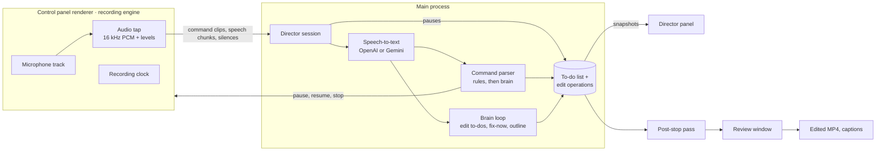

# AI Director — feature plan

> **Status:** Draft v0.2 · **Last updated:** 2026-10-28 ·
> **Decision record:** [ADR-0008](adr/0008-ai-director-cloud-voice-editing.md)
>
> The first AI release, replacing the start of [PLAN.md Phase 3](PLAN.md#phase-3--ai-editing-byok-46-weeks).
>
> **Already in place:** notes while recording ([ADR-0010](adr/0010-notes-while-recording.md))
> provide the microphone tap, speech detection, OpenAI transcription, key storage and `note` events
> that M1 and M2 build on.

AI Director listens while you record and builds a **live to-do list of edits**: what to cut, what
to retake, which pauses to remove, where chapters go, and what you should re-record before you stop.
You add to it by voice ("cut the last four seconds", "retake") and the AI adds what it spots. When
you stop, Kadr carries out the checked to-dos and hands you a cleaned-up, captioned video to review
and export. Version 1 runs on the user's own **OpenAI** or **Gemini** API key.

## 1. Goals and non-goals

**Goals**

1. Record in one take: mistakes are fixed by voice or automatically, not in an editor afterwards.
2. Nothing to remember: every edit you ask for or the AI spots lands on the to-do list during the
   recording, and anything that needs you (a part to re-record) shows up while you can still redo
   it.
3. Trust: every to-do is visible and can be unchecked; edits are non-destructive and the raw
   recording is always kept.
4. Recording never depends on AI: a network or provider failure costs AI features, never footage.

**Non-goals for v1**

- Local models (Whisper, Ollama) and Claude. The provider interfaces stay open for them
  ([ADR-0008](adr/0008-ai-director-cloud-voice-editing.md)).
- Wake word and always-on, hands-free commands.
- Carrying out visual edits (zoom, transitions, blur, images). Said aloud, they are kept as
  "for later" to-dos with their time.
- The web app. The logic lives in shared packages, so it can follow.

## 2. Scope

| ID  | Feature                   | Behavior                                                                                                                            | Milestone |
| --- | ------------------------- | ----------------------------------------------------------------------------------------------------------------------------------- | --------- |
| F1  | AI Director switch        | On/off on the control panel's main view; off by default                                                                             | M1        |
| F2  | Connect OpenAI            | Paste key, test it, choose models                                                                                                   | M1        |
| F3  | Connect Gemini            | Same as F2                                                                                                                          | M1        |
| F4  | Provider per job          | _Listening_ (speech-to-text) and _Brain_ (command fallback, edit to-dos, edit plans) can use different providers                    | M1        |
| F5  | Privacy and cost panel    | What is sent where, estimated cost per 10 minutes, per-recording cost limit                                                         | M1        |
| F6  | Command hotkey            | Tap a global shortcut (or the toolbar mic button) and speak a command                                                               | M2        |
| F7  | Recorder commands         | "pause", "resume", "stop"                                                                                                           | M2        |
| F8  | Edit commands             | "cut the last N seconds", "retake", "undo"                                                                                          | M2        |
| F9  | Hidden commands           | The spoken command is cut from the video                                                                                            | M2        |
| F10 | Chapters and marks        | "chapter: pricing", "mark this"                                                                                                     | M2        |
| F11 | Live edit to-do list      | Every edit (from commands, detected pauses and AI suggestions) appears at once as a to-do in a panel hidden from the capture        | M2        |
| F12 | AI edit to-dos            | The brain spots retakes, false starts, repeated sentences and edits said aloud ("we'll cut this bit") and adds them as to-dos       | M3        |
| F13 | Fix-now to-dos            | Parts only you can fix (a stumble worth re-recording, a skipped outline point) are flagged at once so you redo them before you stop | M3        |
| F14 | Outline checklist         | Draft an outline before recording; points tick off as you cover them; warning at stop                                               | M3        |
| F15 | Review screen             | The to-do list next to a preview: tick or untick each to-do and see the result; edit title and chapters                             | M4        |
| F16 | Remove pauses and fillers | Pause to-dos added live from measured silences (M2); filler-word to-dos after transcription (M4)                                    | M2, M4    |
| F17 | Retake double-check       | After stop, the brain reviews the whole recording and adds retakes and false starts it missed                                       | M4        |
| F18 | Captions                  | Optional burned-in captions; SRT and VTT files                                                                                      | M4        |
| F19 | Title, summary, chapters  | Generated; chapters also come from voice commands and the outline                                                                   | M4        |
| F20 | Open to-dos               | To-dos Kadr can't carry out yet (zooms, transitions, images) stay listed with times; copy or save them as Markdown                  | M4        |

**Later (not in v1):** carrying out zoom, blur, transition and image to-dos; wake word;
hold-to-talk (needs a native key hook); live captions; live coach; open-link commands; translated
captions; auto-zoom on clicks; idle speed-up; smart bubble; secret guard; thumbnails; chat with the
recording; edit by transcript; recording → step-by-step guide; bug reports; vertical teasers;
dubbing; local providers; Claude.

## 3. User experience

### 3.1 Setup: Settings → AI

A new **AI** view in the control panel, next to Bubble, Countdown, Audio and More:

- **OpenAI** and **Gemini** cards: masked key field (after saving, only the last four characters are
  shown), **Test**, a status (Ready / Needs key / Key rejected / Quota exceeded), model pickers with
  recommended defaults, and a link to the provider's key page. The Gemini card notes that Google
  may use free-tier data to improve its products.
- **Use for:** _Listening_ → OpenAI or Gemini; _Brain_ → OpenAI or Gemini. With one provider
  connected, both point to it.
- **Features:** AI edit suggestions, Fix-now to-dos, Outline, Review before export (all on by
  default).
- **Privacy and cost:** what is sent (microphone audio while AI Director is on, transcript text to
  the brain; never the screen, camera, system audio or files), which provider receives each,
  the estimated cost per 10 minutes for the current choices, and a per-recording cost limit
  (default $1.00).

Turning on **AI Director** with no provider connected opens this view.

### 3.2 Before recording

With AI Director on, the main view shows an optional **"What's this video about?"** field. **Draft
outline** asks the brain for 3–6 points, which the user can edit, reorder, delete or replace with
their own. Skipping it is fine.

### 3.3 While recording

The **director panel** is a new content-protected, always-on-top window docked beside the toolbar
and, like the toolbar and countdown, excluded from the capture. It shows the command chip, the
**edit to-do list** and the outline checklist, and collapses to a small badge with counts.

```
Edit to-dos
[x] 0:28  Cut the last 4 s                                  Undo
[x] 0:48  Remove 6 pauses (14 s)
[?] 1:05  Retake? "let me say that again"                   Apply  Skip
[!] 1:10  Re-record: you stumbled on "pricing tiers"
[x] 2:10  Chapter: Pricing
[ ] 2:40  For later: zoom in on the save button
```

| Mark  | State      | Meaning                                                                                                          |
| ----- | ---------- | ---------------------------------------------------------------------------------------------------------------- |
| `[x]` | Will apply | Carried out at export: your commands, pauses, and AI suggestions with confidence ≥ 0.8                           |
| `[?]` | Suggested  | AI suggestion below 0.8; one tap applies or skips it                                                             |
| `[!]` | Needs you  | Needs new footage. When you say it again (or say "retake"), the brain turns the first attempt into a checked cut |
| `[ ]` | For later  | An edit Kadr can't carry out in v1 (zoom, transition, image); kept with its time for the editor                  |
- **Listening indicator** on the toolbar whenever audio is being sent, and a **mic button** that
  does the same as the command hotkey.
- **Command flow:** tap the hotkey → chip "Listening…" → speak → the clip ends after 0.7 s of
  silence, on a second tap, or after 8 s → the new to-do appears at the top of the list.

Commands follow English rules; other phrasings and languages go to the brain:

| Say                                                         | To-do it adds                                                                                                                      |
| ----------------------------------------------------------- | ---------------------------------------------------------------------------------------------------------------------------------- |
| "pause" / "resume" / "stop"                                 | None: same as the toolbar buttons; "resume" works while paused                                                                     |
| "cut (the) last N seconds"                                  | Cut from N s before the tap to the tap (N = 1–60), with the start snapped to the nearest silence                                   |
| "retake", "redo that", "let me try again"                   | Cut back to the start of the current utterance: the latest of the last silence ≥ 0.6 s, last command or last chapter, at most 60 s |
| "undo"                                                      | Removes the previous command's to-do                                                                                               |
| "chapter &lt;title&gt;"                                     | Chapter at the tap                                                                                                                 |
| "mark this" / "highlight"                                   | Highlight marker at the tap                                                                                                        |
| "todo &lt;edit&gt;", e.g. "todo zoom in on the save button" | An edit to-do at the tap; "for later" when Kadr can't carry it out                                                                 |
- Every command clip, recognized or not, is cut from the video (F9).
- When the provider can't be reached, the tap still adds a "check this moment" to-do.
- Restart and discard stay off voice: they destroy the take.
- While **paused**, continuous listening stops; only tapped commands are sent.
- **Stopping with open needs-you to-dos or uncovered outline points** shows them on the toolbar
  with **Stop anyway** and **Keep recording**; pressing stop again confirms.

### 3.4 After stop

1. The raw recording is saved immediately, as today.
2. Kadr finishes transcription and the post-stop pass, which adds filler-word to-dos and any
   retakes the live pass missed (target: ≤ 30 s for a 10-minute recording).
3. The **review window** opens with the to-do list grouped as Your commands · Pauses · Filler
   words · Retakes · For later. Each to-do has a checkbox and "play around this"; the preview
   already plays the result of the checked to-dos, with captions. Title, summary and chapters are
   editable.
4. **Export** carries out the checked to-dos and writes the edited MP4 and optional SRT/VTT files,
   then copies the video to the clipboard when that setting is on. If "for later" to-dos remain, it
   offers to save them as `… to-dos.md`. With _Review before export_ off, Kadr exports
   automatically with the checked to-dos.

## 4. Architecture

### 4.1 Principles

- The AI produces data: session commands from a fixed set, edit to-dos and the edit operations
  behind them, and markers. Never pixels, never arbitrary actions
  ([ADR-0005](adr/0005-ai-edits-as-declarative-edit-plans.md)).
- A to-do is what the user sees; edit operations are what the renderer executes. Each to-do links
  to its operations, and an operation's `status` is the single source of truth for "checked".
- Rules before models: command parsing, silence detection, snapping and chunking are deterministic
  and unit-tested; models handle language.
- Keys and provider calls live in the main process.
- Only microphone audio is sent, never system audio (a video playing on screen must not trigger
  commands). Audio is sent only while AI Director is on, and silence is never sent.

### 4.2 Data flow



### 4.3 Where the code goes

| Piece                                                                                                                    | Location                                                               | Notes                                                                                                                                  |
| ------------------------------------------------------------------------------------------------------------------------ | ---------------------------------------------------------------------- | -------------------------------------------------------------------------------------------------------------------------------------- |
| PCM downmix/resample to 16 kHz mono, WAV encoder, level meter, silence detector, chunker                                 | `packages/recorder-core/src/audio/`                                    | Pure, unit-tested                                                                                                                      |
| Audio tap (AudioWorklet on the mic track), clip capture, recording clock                                                 | `apps/desktop/src/renderer/src/control/director-audio.ts`, `engine.ts` | The engine owns timing because it owns the recorder                                                                                    |
| Voice intents, command rules, to-do list reducer, snapping, brain prompts and schemas, outline, plan merge, caption cues | `packages/ai-editor/src/director/`                                     | Pure, unit-tested                                                                                                                      |
| OpenAI and Gemini adapters                                                                                               | `packages/ai-editor/src/openai/`, `src/gemini/`                        | Entry points `@kadr/ai-editor/openai` and `/gemini`; official SDKs (`openai`, `@google/genai`, both Apache-2.0); imported by main only |
| Default models and prices                                                                                                | `packages/ai-editor/src/models.ts`                                     | One file to update when providers change; `PRICES_AS_OF`                                                                               |
| Key storage                                                                                                              | `apps/desktop/src/main/ai/keys.ts`                                     | `safeStorage`, file in `userData`                                                                                                      |
| Provider registry and key tests                                                                                          | `apps/desktop/src/main/ai/providers.ts`                                |                                                                                                                                        |
| Director session (one per recording)                                                                                     | `apps/desktop/src/main/ai/director.ts`                                 | Speech-to-text, intents, brain loop, to-do list, cost limit, sidecars, snapshots                                                       |
| Post-stop pass                                                                                                           | `apps/desktop/src/main/ai/post-stop.ts`                                |                                                                                                                                        |
| Bundle folders and sidecar writes                                                                                        | `apps/desktop/src/main/recordings.ts`                                  | `RecordingStore` stays the only file-system writer                                                                                     |
| Director panel window                                                                                                    | `renderer/director.html`, `renderer/src/director/`                     | Content-protected                                                                                                                      |
| Review window and export worker                                                                                          | `renderer/review.html`, `renderer/src/review/`                         | Normal window; WebCodecs + Mediabunny                                                                                                  |
| AI settings view                                                                                                         | `renderer/src/control/ControlApp.tsx` (`View` gains `"ai"`)            |                                                                                                                                        |

### 4.4 Timing

The engine starts a `RecordingClock` (`@kadr/recorder-core`) when the `MediaRecorder` starts and
pauses and resumes it with the recorder, so `toMediaTimeUs` gives positions in the raw file. Every
director timestamp (tap, clip end, chunk start, silences) is media time stamped in the renderer;
main forwards the hotkey to the engine instead of stamping it itself. The offset between the clock
and the recorder's own timeline should be tens of milliseconds; snapping to silences absorbs it,
and spike S4 measures it.

### 4.5 Audio tap

An AudioWorklet on the microphone track (before it is mixed with system audio) produces 16 kHz mono
PCM and 20 ms RMS levels.

- **Silence map:** a level below an adaptive noise floor + 10 dB for ≥ 300 ms is silence. Batches
  go to main every 2 s. The map drives pause to-dos (silences ≥ 1.5 s, keeping 0.2 s on each side),
  snapping, retake starts, and skipping silent audio.
- **Command clips:** from the tap to the clip end, encoded as WAV and sent immediately.
- **Speech chunks:** 8–20 s, split at silences (hard maximum 25 s), never containing a command clip,
  skipped when they contain no speech, and only produced while recording.

At 32 KB/s of speech, 10 spoken minutes upload about 19 MB; compressed audio is a later
optimization.

### 4.6 Speech-to-text

`TranscriptionProvider` gains an optional `prompt` (a vocabulary hint such as "todo, retake,
chapter"). Command clips and speech chunks go to the listening provider, and the director places
the results on the media timeline as `Transcript` words:

- **OpenAI:** a model with word timestamps where available (`timing: "word"`).
- **Gemini:** segment timing, with words spread across each segment (`timing: "segment"`).

Spike S1 picks the default models and decides whether Gemini timing is good enough for filler
to-dos. Pause to-dos never depend on provider timing.

### 4.7 Commands

`VoiceIntent` is a Zod discriminated union: `pause | resume | stop | cutLast { seconds } | retake |
undo | chapter { title } | mark | todo { text } | unknown`.

1. `parseCommand(text)` applies the rules: verbs, number words and units, tolerant of fillers and
   punctuation. Tests are a table of utterances and expected intents.
2. No match → brain fallback with the intent JSON Schema as structured output and a 3 s timeout;
   the response is validated with `VoiceIntent`. The brain also decides whether a `todo` is
   something Kadr can carry out (a cut between two moments) or "for later".
3. `unknown` → chip "Didn't catch that". The clip is still cut.

### 4.8 To-do list reducer

A pure reducer, `applyIntent(state, intent, timing, silences)`, returns the next state: the to-dos,
the edit operations behind them (in `edits/director.json`, `source.kind: "user"`, each operation
with an `origin`), markers, and the undo stack. Detected pauses and brain suggestions go through
the same reducer with their own inputs.

- **Hidden command cut:** from the silence start just before the tap (at most 0.3 s back) to the
  clip end + 0.15 s. Not listed as a to-do of its own.
- **`cutLast`:** from tap − N s, snapped to a silence within ±0.5 s and never before the recording
  start; merged with the hidden cut.
- **`retake`:** starts at the latest of the last silence ≥ 0.6 s, the last command end and the last
  chapter, at most 60 s back.
- **`pause` / `stop`:** the hidden cut runs to the pause or stop point, which also removes the second
  the speech-to-text took.
- **`undo`:** removes the previous command's to-do with its operations and markers.
- **Pauses** are merged into one grouped to-do per recording ("Remove 6 pauses (14 s)") that expands
  in review.
- Cuts never overlap (`validateEditPlan`); overlapping to-dos share the merged operation.

### 4.9 Brain loop (F12–F14)

After each transcribed chunk, at most once every 20 s:

- **Input:** the outline, the current to-dos (ids, kinds, times), and the last ~3 minutes of
  transcript. Stable content goes first so provider-side prompt caching applies.
- **Output:** structured JSON validated with Zod and length-limited: suggested edit to-dos with a
  kind (`retake | falseStart | repeat | spokenEdit | reRecord | forLater`), a time range, a quote
  and a confidence; resolved `reRecord` ids; covered outline ids.
- **Mapping:** ranges are snapped to silences and become cut operations; confidence ≥ 0.8 starts
  checked, lower starts as suggested. `reRecord` to-dos have no operation until the brain hears the
  passage again; then the first attempt becomes a checked cut and the to-do is resolved.
- **Duplicates** are dropped by overlap with existing to-dos.
- **Cost:** usage from each response is added up; at the limit the loop stops (chip "AI paused:
  cost limit") while commands and pause to-dos keep working.

Drafting the outline is a single brain call before recording.

### 4.10 Post-stop pass (F16, F17, F19)

1. Flush the last chunk and write `transcript.json`.
2. Filler-word to-dos from transcript words when `timing` is `"word"` (existing
   `detectFillerWords`).
3. Brain double-check of the whole recording: `EDIT_PLAN_SYSTEM_PROMPT` (bump `PROMPT_VERSION`) for
   missed retakes and false starts, title, summary and chapters, with context from
   `buildEditContext` plus the to-do list and outline coverage.
4. `mergePlans` adds the new suggestions to the to-do list (dropping ones that overlap existing
   to-dos), validates the operations, and writes `edits/<id>.json` and `todos.json`.

### 4.11 Review and export (F15, F18, F20)

- **Playback:** main serves the raw take read-only from the app protocol under an opaque id
  (`kadr://app/media/<id>`) mapped to a path inside the recordings folder. URLs never carry paths,
  and the route is same-origin, so the CSP doesn't change. It must support range requests for
  seeking. Dev mode loads pages from `localhost`, which spike S4 checks.
- **Preview:** plays the raw file and jumps over the cuts of checked to-dos
  (`requestVideoFrameCallback`); captions are a DOM overlay. Ticking a to-do updates the preview at
  once.
- **Export:** a worker in the review window demuxes with Mediabunny (MPL-2.0, already the planned
  muxer), decodes with WebCodecs, drops the cut ranges, draws frames (and burned-in captions) on an
  `OffscreenCanvas`, encodes H.264 + AAC (hardware preferred; Opus if AAC encoding is unavailable,
  see S2), fades audio for 15 ms at every join, and streams the MP4 to main through
  `RecordingStore`.
- **Captions:** cues from the transcript, remapped to the edited timeline (≤ 42 characters per line,
  2 lines, ≤ 7 s per cue). `toEditedTime(us, cuts)` is pure and shared by the preview, the export
  and SRT/VTT.
- **Open to-dos:** `- [ ] 02:15 Zoom in on the save button`, with times on the edited timeline.

Files, next to today's recordings:

```
Videos/Kadr/
  Kadr 2026-10-28T10-00-00.kadr/      bundle: raw take + sidecars
    manifest.json
    composite.mp4                     raw MediaRecorder take
    events.jsonl
    transcript.json
    todos.json                        edit to-do list and outline
    edits/director.json
    edits/<merged-plan-id>.json
  Kadr 2026-10-28T10-00-00.mp4        edited export
  Kadr 2026-10-28T10-00-00.srt        optional
  Kadr 2026-10-28T10-00-00 to-dos.md  only when "for later" to-dos remain
```

With AI Director off, recording behaves exactly as today. Sidecars are written during the recording
(events appended, `todos.json` rewritten atomically), so a crash keeps the to-do list.

### 4.12 Providers

- Adapters implement `LlmProvider` and `TranscriptionProvider` with structured output (each
  provider's JSON-schema response mode), an `AbortSignal`, a timeout, and retries with backoff on
  429 and 5xx responses.
- Errors map to `ProviderError { kind: "auth" | "quota" | "rate" | "network" | "invalid" | "server" }`
  for friendly messages. Request and response bodies are never logged.
- Hosts are fixed to each provider's official API; there are no custom base URLs in v1. A fake
  provider exists only in e2e builds (compiled in by a build flag and absent from release builds).
- `models.ts` holds the default model per provider and job (listening, fast brain, post-stop brain),
  chosen in spike S1. Users can pick any model the provider lists.

### 4.13 Settings, keys and IPC

A new `ai` settings section, validated with Zod and falling back section by section like the
others:

```ts
ai: {
  directorEnabled: boolean; // default false
  listening: "openai" | "gemini" | null;
  brain: "openai" | "gemini" | null;
  models: { openai?: ModelChoice; gemini?: ModelChoice }; // overrides of the defaults
  aiSuggestions: boolean;
  fixNowTodos: boolean;
  outline: boolean;
  reviewBeforeExport: boolean;
  costLimitUsd: number; // default 1
}
```

Keys never go into settings. `KeyStore` encrypts them with `safeStorage` into `ai-keys.json` in
`userData`. When encryption is unavailable (Linux without a keyring uses the `basic_text` backend),
the key is kept for the session only and the card says so. Renderers can set, remove and test a key
but never read it back.

New IPC, each through `api.ts` → preload → `ipc.ts` with Zod and a sender check:

| Channel                                                                                     | Direction                        | Allowed senders          |
| ------------------------------------------------------------------------------------------- | -------------------------------- | ------------------------ |
| `ai:status`, `ai:set-key`, `ai:remove-key`, `ai:test`, `ai:list-models`, `ai:draft-outline` | control → main                   | Control window           |
| `director:hotkey`                                                                           | main → engine                    | —                        |
| `director:clip`, `director:chunk`, `director:silences`                                      | engine → main                    | Control window           |
| `director:changed`                                                                          | main → director, toolbar, review | —                        |
| `todos:set-checked`, `todos:undo`, `todos:edit`, `todos:remove`                             | director, review → main          | Director, review windows |
| `review:get`, `review:update-meta`, `export:begin`, `export:chunk`, `export:finish`         | review → main                    | Review window            |

`SHORTCUT_CANDIDATES` gains `command` (for example `Alt+Shift+Space`, `Alt+Shift+C`), registered
only while a recording with AI Director is active; the UI shows whichever was registered. Electron's
`globalShortcut` fires on key press only, which is why v1 is tap-to-talk. Hold-to-talk waits for
the native key hook planned for click capture (`uiohook-napi`).

### 4.14 Format changes

All additive within `FORMAT_VERSION` 1 in `@kadr/project-format`:

- `RecorderEvent`: `voice.command { t, durationUs, intent, text? }`. Older readers report the unknown
  lines and skip them (`parseEventsJsonl`).
- `todos.json` (`BUNDLE_LAYOUT.todos`):
  `EditTodos { formatVersion, outline[{ id, text, coveredAtUs? }], todos[EditTodo] }` with
  `EditTodo { id, text, kind, atUs, endUs?, source: "voice" | "detected" | "ai", operationIds[],
  done?, quote?, confidence? }`. `kind` is one of `cut | retake | pauses | fillers | falseStart |
  repeat | chapter | marker | reRecord | forLater`. For to-dos with operations, "checked" is their
  operations' `status`; `done` is only for to-dos without operations (re-record, for later).
- `Transcript.timing?: "word" | "segment"`.
- Edit operations: optional `origin?: "voice" | "silence" | "filler" | "retake" | "falseStart" |
  "manual"`, used to group edits in review.
- JSON Schemas regenerated, with schema tests for each addition.

No new operation types, so no version bump.

## 5. Privacy and security

- AI Director is off by default. When on, only microphone audio goes to the listening provider and
  only transcript text goes to the brain. The screen, camera, system audio, window titles and files
  are never sent.
- The listening indicator shows whenever audio is being sent; silence and paused time are not sent.
- Keys are encrypted with the OS keychain via `safeStorage`, used only in main, never logged, and
  sent only to the provider's API host.
- Voice can trigger only the intents in §4.7. Model output is validated, length-limited and rendered
  as text.
- The media route serves only registered ids inside the recordings folder, read-only.
- Before release, update `PRIVACY.md` (its "the only network request the desktop app makes on its
  own is the update check" stops being true when AI Director is on) and `docs/USER_GUIDE.md`.

## 6. Cost

The AI view and the review summary show estimates from the prices in `models.ts` (labelled with
their date) and actual usage from provider responses. For 10 minutes with fast models: speech-to-text
for the spoken minutes plus about 30 brain calls of ~3k input tokens, i.e. a few cents. The
per-recording limit (default $1) pauses the brain loop, never commands, pause to-dos or the
recording.

## 7. Milestones

Estimates assume 1–2 engineers working with Claude Code; about 9 weeks in total.

### M0 — Spikes (3–4 days)

- **S1 Speech-to-text:** OpenAI vs Gemini on ~30 fixture clips (commands and speech; English,
  Russian, Uzbek): latency p50/p95 for 2–4 s clips, accuracy, timestamp precision, cost. Output:
  default models, and whether Gemini timing supports filler to-dos.
- **S2 Export:** Mediabunny + WebCodecs on real `MediaRecorder` output (MP4/H.264 on Windows, WebM
  fallback) in Electron on Windows and macOS: H.264/AAC encoder availability and speed for a
  10-minute 1080p recording.
- **S3 Brain loop:** structured-output reliability, latency and cost on both providers' fast models
  with 10-minute transcript fixtures containing retakes, false starts and spoken edits.
- **S4 Audio and timing:** AudioWorklet under the app CSP in a sandboxed renderer, CPU cost,
  clock-vs-recorder offset, media route in dev mode.

**Exit:** results recorded (ADR-0008 or a follow-up ADR) and the questions in §11 answered.

### M1 — Foundations: F1–F5 (1.5 weeks)

- `@kadr/project-format` additions, tests and JSON Schema.
- `@kadr/ai-editor`: OpenAI and Gemini adapters, `ProviderError`, `models.ts`, cost estimates; tests
  replay recorded responses (no network in CI).
- Desktop: `ai` settings section, `KeyStore`, `ai:*` IPC, AI view with provider cards, per-job
  choice, privacy and cost panel, AI Director switch.
- Recordings become bundles when AI Director is on: bundle folders in `RecordingStore`, manifest,
  `events.jsonl`, `RecordingClock` in the engine.

**Exit:** both keys can be added, tested and removed; a recording with AI Director on produces a
valid bundle; `corepack pnpm check` passes.

### M2 — Voice commands and the live to-do list: F6–F11, F16 pauses (1.5 weeks)

- `recorder-core` audio modules; engine audio tap, clip capture and silence batches.
- `command` shortcut, toolbar mic button and listening indicator.
- `ai-editor` intents, rules, brain fallback, to-do list reducer, snapping, undo, pause to-dos.
- Main `DirectorSession`: clip speech-to-text → intents → engine commands and to-dos; sidecar
  writes.
- Director panel window: command chip, edit to-do list (check, skip, undo).

**Exit:** every command works in a real recording; end of speech → to-do ≤ 2.5 s p95 on a normal
connection; command audio is cut; pauses appear as to-dos while recording; an e2e test covers the
flow with the fake provider.

### M3 — AI edit to-dos: F12–F14 (1.5 weeks)

- Speech chunks → live transcript; brain loop with suggestion mapping, re-record resolution,
  deduplication and the cost limit.
- Outline drafting in the control panel, checklist and coverage in the director panel, stop warning.

**Exit:** in 5 dogfood recordings, most retakes and false starts appear as to-dos within 30 s, with
at most one wrong suggestion per 10 minutes (thresholds calibrated in S3); CPU within §9.

### M4 — Review and export: F15–F20 (2.5 weeks)

- Post-stop pass (filler to-dos, retake double-check, title, summary, chapters) and merge; media
  route; review window built around the to-do list; export worker with audio fades and captions;
  SRT/VTT; open to-dos file; clipboard copy; automatic export when review is off.

**Exit:** to-do list complete ≤ 30 s after stopping a 10-minute recording; export ≤ 90 s on
reference hardware; joins inaudible in dogfood listening.

### M5 — Hardening and beta (1 week)

- E2E flows, prompt evaluation fixtures per `PROMPT_VERSION`, performance check, docs
  (`USER_GUIDE.md`, `PRIVACY.md`, ARCHITECTURE §5, the window table in `apps/desktop/CLAUDE.md`),
  changesets.
- Ship as **AI Director (beta)**.

**Exit:** the definition of done in `CLAUDE.md`, including `test:e2e`.

## 8. Testing

- **Unit** (Vitest, next to the code): audio math, chunker, silence detection, command rules (a
  table of utterances → intents), to-do reducer and snapping (timelines in, to-dos and operations
  out), brain response validation and mapping, re-record resolution, plan merge, time remapping,
  caption cues, cost estimates, settings parsing, key-store logic with a fake `safeStorage`.
- **Adapters:** recorded provider responses replayed through each SDK's custom `fetch`; no network
  in CI.
- **E2E** (Playwright, production build with the e2e flag): connect the fake provider, record with
  commands, and check the director panel's to-do list, the bundle files, the review window and the
  export.
- **Prompt evaluations:** fixture transcripts with the expected edit to-dos, run with real keys
  outside PR CI; results tracked per `PROMPT_VERSION`.

## 9. Budgets

| Metric                                  | Target                       |
| --------------------------------------- | ---------------------------- |
| End of a spoken command → to-do         | ≤ 1.5 s p50, ≤ 2.5 s p95     |
| Extra CPU while recording               | ≤ 3% of one core             |
| Extra memory                            | ≤ 50 MB                      |
| To-do list complete after stop (10 min) | ≤ 30 s                       |
| Export of a 10-minute 1080p recording   | ≤ 90 s on reference hardware |
| Footage lost because of AI failures     | 0                            |

## 10. Risks

| Risk                                                        | Mitigation                                                                        |
| ----------------------------------------------------------- | --------------------------------------------------------------------------------- |
| Misheard or accidental commands                             | Tap-to-talk, rules first, undo, everything non-destructive                        |
| A cluttered to-do list distracts while recording            | Pauses grouped into one to-do; only suggested and needs-you to-dos draw attention |
| Network drops mid-recording                                 | Recording is independent of AI; taps still add "check this moment" to-dos         |
| Imprecise provider timestamps                               | Cuts snap to locally measured silences; S1 measures the rest                      |
| Surprise costs                                              | Estimates, silence never sent, per-recording limit                                |
| Privacy concerns                                            | Off by default, microphone only, indicator, updated privacy statement             |
| H.264/AAC encoding unavailable in WebCodecs on some systems | S2; Opus/WebM fallback                                                            |
| Provider API and model churn                                | Official SDKs, models in one file, user-selectable models                         |
| Moving away from local-first AI                             | ADR-0008 records it; the same interfaces accept local providers later             |

## 11. Open questions

1. Default command hotkey candidates (check for conflicts on Windows and macOS).
2. Which languages get command rules after English (Russian, Uzbek?). The brain fallback covers the
   others meanwhile.
3. Burned-in captions on or off by default, and the caption style.
4. The default cost limit.
5. Whether to bring AI Director to the web app after v1.
