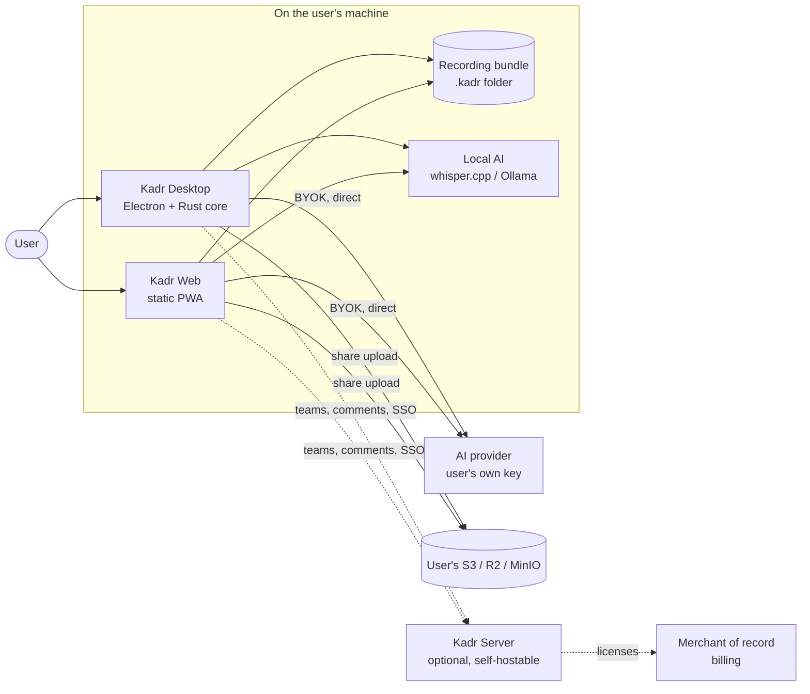
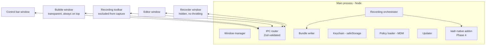
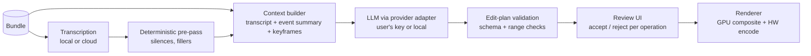

# Kadr — Architecture

> **Status:** Draft v0.1 · Decisions referenced here are recorded in [adr/](adr/README.md).

## 1. System context



Everything inside "On the user's machine" works with no network. Dotted lines are optional.

## 2. Repository layout

```
apps/
  desktop/            Electron app (main, preload, renderer windows)
  web/                Static web app (browser recorder, editor, watch page)
  server/             Kadr Server — Phase 5 (not yet created)
packages/
  project-format/     Zod schemas + JSON Schema for the .kadr bundle, events, transcript, edit plans
  compositor/         Bubble shapes, layout math, canvas compositor, render loop
  recorder-core/      Browser recording primitives: clock, event log, track recorder, audio mixing
  ai-editor/          Provider-agnostic AI editing: context building, heuristics, edit-plan validation
  ui/                 Shared React components (shape icons today; design system later)
crates/
  kadr-native/        Rust native core (napi-rs) — capture, encode, input hooks (Phase 4)
docs/                 Plan, architecture, ADRs
```

Packages are TypeScript "internal packages": they export source and are compiled by the consuming
app's bundler, so there is no per-package build step during development ([ADR-0006](adr/0006-monorepo-tooling.md)).
`project-format` will additionally be published to npm (with JSON Schemas) so third parties can read
and write Kadr bundles.

## 3. Desktop app

### 3.1 Process and window model



| Window            | Properties                                                                                                             | Purpose                                                                                                                     |
| ----------------- | ---------------------------------------------------------------------------------------------------------------------- | --------------------------------------------------------------------------------------------------------------------------- |
| Control panel     | Frameless, transparent card near the top-right; closes to the system tray                                              | Source, camera and mic rows with On/Off toggles and a live mic meter; Start; Bubble / Countdown / Audio / More settings ✅  |
| Bubble            | Transparent, frameless, always-on-top (`screen-saver` level), all workspaces; click-through outside the shape; JS drag | Live camera preview in the chosen shape with automatic light correction; shown while the panel is open or recording ✅      |
| Recording toolbar | Vertical pill on the left edge, content-protected (excluded from capture), click-through outside the pill              | Stop, timer, pause/resume, restart and discard (with confirmation), mic mute, camera toggle ✅ — draw and mark mistake next |
| Countdown         | Centered transparent window (over the region, if any), content-protected                                               | 3-2-1 with synthesized tones; Enter starts now, Esc cancels ✅                                                              |
| Region picker     | One transparent, always-on-top overlay per display, below the bubble                                                   | Draw, move, resize, aspect presets, exact size, keyboard control; remembers the last area ✅ (ADR 0007)                     |
| Region frame      | Click-through, content-protected window just outside the recorded area                                                 | Marks what is being recorded; red, amber while paused ✅                                                                    |
| Recording engine  | Lives in the control panel renderer (`backgroundThrottling: false`)                                                    | Capture + encode pipeline; reports state to main, which choreographs the windows                                            |
| Editor, Settings  | Normal windows                                                                                                         | Editing, preferences, keys                                                                                                  |

### 3.2 Security baseline (implemented in Phase 0)

- `contextIsolation: true`, `sandbox: true`, `nodeIntegration: false` for every renderer.
- Renderers talk to main only through a typed `window.kadr` bridge (preload + `contextBridge`); every
  IPC payload is validated with Zod in the main process.
- Production content is served from a privileged custom protocol `kadr://app/` (not `file://`) with a
  strict Content-Security-Policy header.
- All navigation and `window.open` are denied; permission requests are allowed only for `media` and
  `display-capture` from the app's own origin.
- Display capture goes through `session.setDisplayMediaRequestHandler` (`main/capture.ts`), so the
  main process controls exactly which source a renderer may record: the primary display, or the one
  with the selected region and never another (ADR 0007).
- Planned: Electron Fuses, ASAR integrity, signed and notarized builds (see PLAN §7).

### 3.3 Live bubble: two capture modes

|                           | Mode A — bubble in the screen capture | Mode B — bubble re-composited (default target)                                                 |
| ------------------------- | ------------------------------------- | ---------------------------------------------------------------------------------------------- |
| Screen capture            | Includes the bubble window            | Excludes the bubble window                                                                     |
| Camera                    | Only what the bubble shows on screen  | Separate full-resolution track                                                                 |
| Output                    | Exactly what the user sees            | Also exactly what the user sees — a GPU compositor redraws the bubble from the layout timeline |
| Edit later (AI or manual) | Bubble is baked in                    | Bubble can be moved, resized, hidden, or switched to full-screen camera                        |
| Availability              | All platforms (Phase 0)               | Windows in Phase 1 (`WDA_EXCLUDEFROMCAPTURE`), macOS/Linux in Phase 4 (native exclusion)       |

Shape changes are live in both modes. In Mode B every bubble change is written to the event log as a
`bubble.layout` event, which is what the compositor and the editor replay.

**Shapes** are defined once in `@kadr/compositor` as SVG paths in a unit box (or as rounded rectangles
for non-square shapes). The same definition drives the CSS clip path of the bubble window and the
`Path2D` used by the canvas compositor, so the preview and the recording always match.

### 3.4 Recording pipeline

**Phase 0 (skeleton):** renderer `getDisplayMedia` (source chosen by main) + microphone → audio mixed
with Web Audio → `MediaRecorder` with 1 s timeslices → chunks streamed over IPC → appended to disk.

**Phase 1 (Chromium pipeline):**

```
screen track ─┐                                 ┌─► tracks/screen-0.mp4   (fMP4, HW H.264)
camera track ─┼─► MediaStreamTrackProcessor ──► ├─► tracks/camera.mp4
mic / system ─┘   (worker)                      ├─► tracks/microphone.m4a
                      │                         └─► composite.mp4 (live compositor → encoder)
                      └─ VideoFrame timestamps (one monotonic clock)
WebCodecs VideoEncoder/AudioEncoder (prefer-hardware) → Mediabunny muxer → fragments every 1 s
```

**Phase 4 (native):** `kadr-native` captures (WGC / ScreenCaptureKit / PipeWire), composites with
`wgpu`, and encodes with OS hardware encoders, writing the same bundle layout. The renderer only shows
previews. Because the bundle format is identical, the editor and AI pipeline do not change.

**Clock and sync:** all tracks and events use microseconds since recording start on one monotonic clock.
Pauses are recorded as segments, not by stopping the clock. Drift is measured in CI with a test
pattern (flash + beep) recording.

**Crash safety:** fragmented MP4 is readable up to the last complete fragment; the manifest is
rewritten atomically (write temp + rename) on every segment boundary.

## 4. Recording bundle (`.kadr`)

A recording is a folder (zipped as a single `.kadr` file for transfer):

```
my-recording.kadr/
  manifest.json          format version, tracks, segments, durations, app info
  tracks/
    screen-0.mp4
    camera.mp4
    microphone.m4a
    system-audio.m4a
  composite.mp4          optional rendered output / cache
  events.jsonl           one RecorderEvent per line (cursor, clicks, focus, bubble, markers…)
  transcript.json        word-level transcript
  edits/
    <edit-plan-id>.json  non-destructive edit plans (AI or manual), versioned
  thumbs/                keyframes for previews and vision models
```

The schemas live in `@kadr/project-format` (Zod, exported as JSON Schema). The format is versioned
(`formatVersion`); readers must reject unknown major versions and ignore unknown fields.

**Event log (privacy rules):** cursor position and clicks are normalized to the captured surface (0–1).
Keyboard activity is recorded as counts per time bucket only — never key contents. Window titles are
opt-in. Event capture is local; it is sent to an AI provider only as a compact summary when the user
runs an AI edit.

## 5. AI editing pipeline



- **AI never edits pixels.** It returns an `EditPlan` (cuts, speed changes, zooms, bubble layouts,
  blurs, chapters, title, summary). A deterministic renderer applies it. Plans are stored in `edits/`,
  so edits are reversible, diffable, and reproducible.
- **Provider adapters** implement one small interface (`LlmProvider`, `TranscriptionProvider`). Each
  adapter uses the provider's official SDK (e.g. `@anthropic-ai/sdk` for Claude). Any OpenAI-compatible
  endpoint covers Ollama, llama.cpp, vLLM and LocalAI.
- **Keys** are stored in the OS keychain via Electron `safeStorage` (desktop) or kept in memory /
  encrypted IndexedDB (web). Requests go directly from the client to the provider.
- **Cost control:** token estimate and price shown before each run; transcripts are reused across
  follow-up edits (prompt caching where the provider supports it).
- **Live during capture:** streaming transcription, voice-activity detection and scene-change detection
  run while recording, so the edit plan can be requested the moment the user stops.
- **Provenance:** every plan records provider, model, prompt version and timestamp.

## 6. Web app

Same React UI and packages, running in the browser:

- Capture: `getDisplayMedia` (screen/window/tab) + `getUserMedia`; the bubble is composited into the
  recording (a web page cannot float a shaped window over other apps).
- Rendering loop driven by a Web Worker timer, because browsers throttle `requestAnimationFrame` in
  hidden tabs. Phase 2 moves composition into a worker (`MediaStreamTrackProcessor` + `OffscreenCanvas`
  - WebCodecs).
- Deployed as static files (any CDN or `nginx`); works offline as a PWA.

## 7. Kadr Server (Phase 5+, optional)

- TypeScript (Hono) + PostgreSQL (Drizzle) + S3-compatible storage; stateless, horizontally scalable.
- Responsibilities: share pages (OG/oEmbed), comments, reactions, analytics, workspaces, upload
  coordination (multipart presigned URLs), transcoding jobs (ffmpeg → HLS), billing webhooks,
  license issuance, and in Enterprise: SSO, SCIM, audit log, policy distribution.
- Deploy: Docker Compose and Helm chart; OpenTelemetry traces/metrics/logs; OpenAPI-described API.

**Licenses / subscriptions:** the merchant of record calls a webhook → the server issues an
Ed25519-signed license token (plan, seats, expiry). The desktop app verifies it offline with an
embedded public key and refreshes it periodically. No server call is needed to start recording.

## 8. Distribution and updates

- `electron-builder`: NSIS (Windows), DMG + zip (macOS), AppImage + deb (Linux); MSI and PKG for
  managed deployment later.
- Auto-update with `electron-updater` from a static feed on Cloudflare R2 (`generic` provider):
  `latest*.yml` / `beta*.yml` metadata with SHA-512 checksums next to immutable installers. The
  feed URL is baked in at build time (`KADR_UPDATE_URL`); builds without it have no feed.
  `main/updater.ts` checks after launch and every 4 h, downloads in the background, installs on
  quit or on "Restart to update", never during a recording, and never downgrades. Channels:
  `stable`, `beta`. Enterprise can disable updates (`KADR_DISABLE_UPDATES=1`) or build with an
  internal mirror as the feed. Details: [RELEASING.md](RELEASING.md).
- Signing: Apple Developer ID + notarization; Windows via Azure Trusted Signing (or EV certificate).

## 9. Observability and privacy

- Telemetry is **off by default**; opt-in anonymous usage metrics and crash reports (Sentry-compatible,
  self-hostable with GlitchTip). No recording content, transcripts, or keys are ever included.
- Server: OpenTelemetry for traces, metrics, and logs; audit log is a separate append-only stream.
